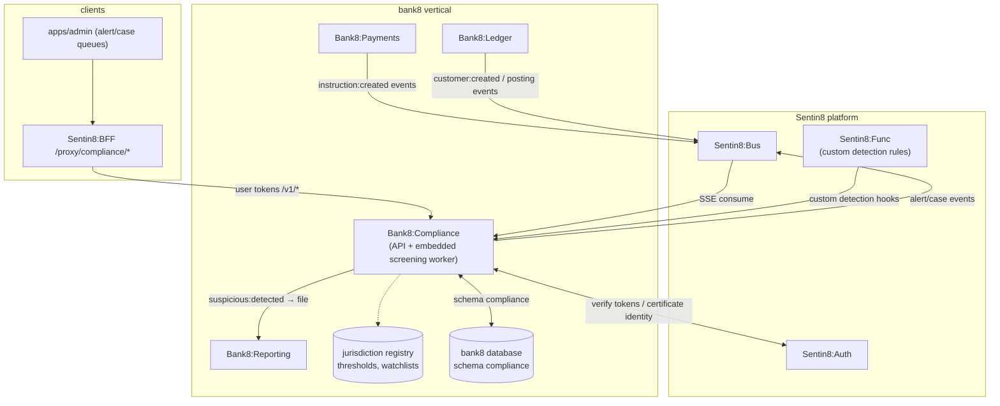

# Bank8:Compliance - README

AML/CTF and sanctions: customer risk rating, KYC/CDD and beneficial
ownership, PEP determination, sanctions screening, real-time transaction
monitoring, and alert/case management - detecting suspicious activity
and filing it through Bank8:Reporting.

## Summary

Bank8:Compliance is a Rust service owning the `compliance` schema in the
bank8 vertical database. It screens customers and transactions against
sanctions watchlists, runs AML/CTF transaction monitoring rules in
real time, manages the alert-to-case lifecycle, and records KYC/CDD,
beneficial-ownership, and PEP determinations. It *detects* suspicious
activity and hands the STR/SAR/CTR/EFTR/LCTR filing to Bank8:Reporting -
the vertical's single filing executor.

## Motivation

Financial-crime obligations are real-time and event-driven: a
transaction must be screened and monitored at the moment it happens,
not during a nightly batch. Compliance keeps the detection surface
(watchlists, monitoring rules, customer risk ratings, alert queues)
separate from both the money-movement hot path and the filing mechanism,
so a suspicious-activity detection becomes a filing without a bespoke
internal API.

## Architecture & High-Level Design

## Key Traits and Data Structures

- `CustomerRiskProfile` - a customer's AML risk rating (low/medium/high)
  and its rationale, recomputed from KYC and transaction behavior.
- `KycRecord` / `BeneficialOwner` / `PepDetermination` - customer due
  diligence, ownership structure, and PEP status.
- `SanctionsScreen` - a screening result against a watchlist snapshot;
  hits generate alerts.
- `MonitoringRule` - a declarative AML rule (threshold, aggregation
  window) resolved from the jurisdiction registry.
- `Alert` / `Case` - the detection-to-investigation lifecycle with an
  audited actor claim.

## Rationale, Trade-offs, and Alternatives

- **Detection here, filing there** - the vertical's single-filing-executor
  rule: Compliance emits `bank8:compliance:suspicious:detected`; Reporting
  files it. No shared table grant, no dual filing paths.
- **Real-time, event-driven** - screening rides `bank8:payments:instruction:created`
  and `bank8:ledger:customer:created` events with a full snapshot payload,
  minimizing read-back (principles §4.7, event-first).
- **Thresholds are jurisdiction data** - LCTR/EFTR (Canada), CTR/SAR (US),
  AMLD/EBA thresholds (EU), MLR (UK) live in the registry, never in code.

See `DESIGN.md` for the wire-level detail and `BUSINESS.md` for the
business capabilities.

---

**Design attribution:** bank8:compliance and its underlying concepts were designed by Hamid Jahanzad <Hamid@Jahanzad.com>.
